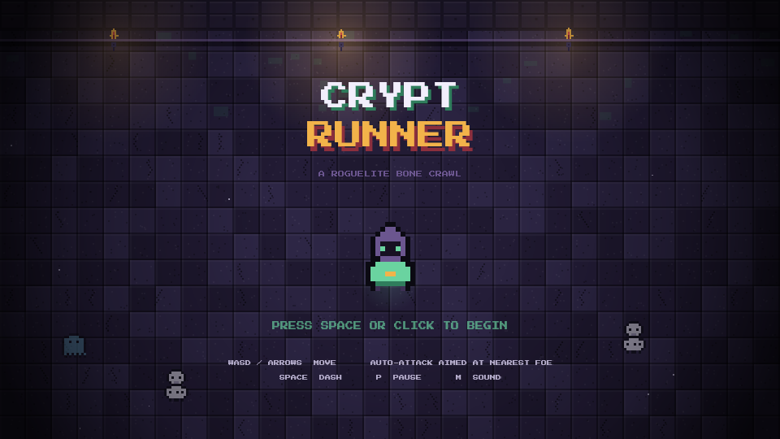
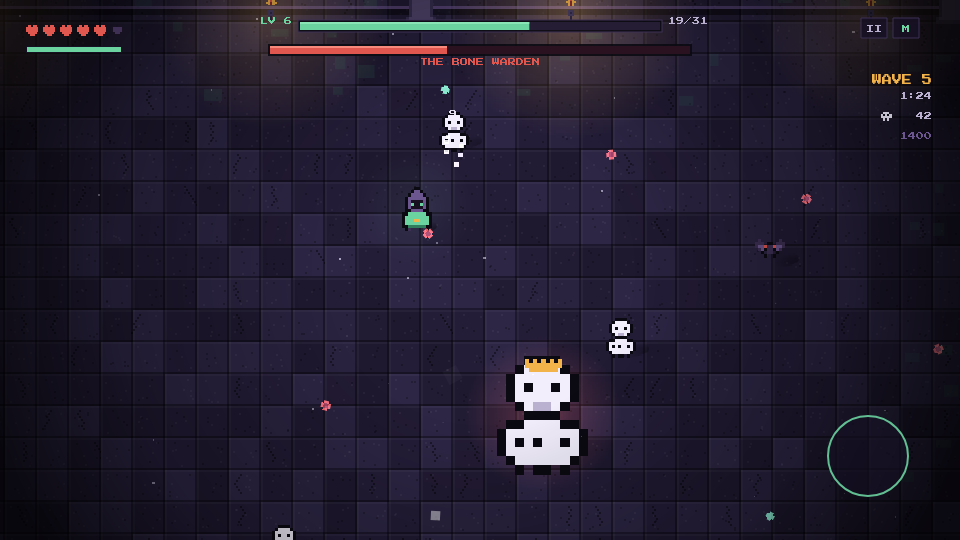

# Crypt Runner

A pixel-art **roguelite arena survival** game built with **Phaser 3** and vanilla ES modules.
You're a hooded runner trapped in a bone pit: bolts fire automatically at the nearest foe, you
dodge what you can't outrun, and every level-up hands you a choice of three blessings. Survive
the waves — a crowned **Bone Warden** shows up every fifth one.





## Play

```bash
npm install
npm run dev      # http://localhost:3000
```

Or build a static bundle:

```bash
npm run build    # -> dist/
npm run preview
```

No build step is needed to *play* the deployed game — the dev server serves it directly.

## Controls

| Action | Keyboard | Touch / mouse |
| --- | --- | --- |
| Move | `WASD` / arrow keys | drag the on-screen stick (left side) |
| Dash (i-frames) | `Space` | round button, bottom right |
| Pick upgrade | `1` `2` `3` or click | tap a card |
| Pause | `P` / `Esc` | `II` button, top right |
| Sound on/off | `M` | `M` button, top right |
| Retry after death | `R` | click / tap |

Attacks are automatic — you aim by **positioning**. Bolts always target the closest enemy, so
walking into a gap in the swarm points your fire where you need it.

## What's in the box

- **Wave survival** with escalating spawn budgets and four enemy types plus a boss.
- **Twelve upgrades** with per-upgrade level caps, so builds specialise over a run.
- **Roguelite pacing**: XP gems, level-up card picks, wave-clear heals, best score in `localStorage`.
- **Boss fight** every 5th wave: charges the player, fires a radial bone burst, summons minions,
  with its own health bar.
- **Game feel**: screen shake, hit flashes, damage numbers, particle bursts, dash afterimages,
  torch flicker, vignette, procedural score/footstep-free synth SFX and a looping dark ambient track.
- **Touch controls** that appear automatically on touch devices.

## Architecture

```
index.html            page shell (Phaser mounts into #game)
src/
  main.js             waits for the pixel font, then launches the game
  game.js             Phaser config + scene list
  const.js            layout, palette, depths, base player stats  <- tune balance here
  art.js              every texture: pixel-grid sprites + procedural stonework/vignette/glows
  audio.js            WebAudio synth (SFX + music sequencer), no audio files
  upgrades.js         the blessing pool
  entities/
    Player.js         movement, dash, auto-attack, damage, i-frames
    Enemy.js          enemy definitions + steering, knockback, boss behaviour
    Bullet.js         pooled projectile
  scenes/
    Boot.js           generates all art, then hands off to the title
    Title.js          animated title screen
    Game.js           the run: waves, spawning, collisions, HUD, upgrades, pause, game over
```

**No image or audio assets.** Character sprites are string pixel-art grids drawn into canvases at
boot, the crypt floor is procedurally painted with deterministic noise (cracks, moss, bevels), and
every sound is synthesised at runtime. That keeps the repo tiny and the art palette consistent.

### Tweaking

- `src/const.js` → `BASE_STATS`: player damage, fire rate, speed, dash, magnet, hearts.
- `src/entities/Enemy.js` → `ENEMY_TYPES`: hp, speed, damage, xp, hitbox, burst particles.
- `src/scenes/Game.js` → `startWave()` / `pickEnemyType()`: wave size and enemy mix curve.
- `src/upgrades.js` → add `{ id, name, icon, max, desc, apply }` and it enters the level-up pool.
- `src/art.js` → `ART`: edit a grid and the sprite changes everywhere (`.`, or palette keys).

## Notes

Built as a single-session project. Verified by running the game headlessly in jsdom with
Phaser's Canvas renderer (`@napi-rs/canvas`) to screenshot and smoke-test each scene; the deployed
build uses Phaser's WebGL renderer, where tint effects (frost, boss aura, icon colours) are richer
than the screenshots above suggest.
